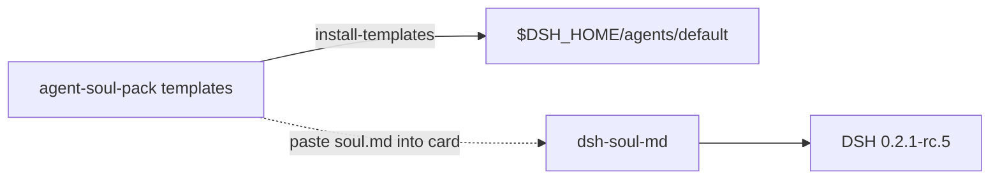

# agent-soul-pack

**狀態：M0 scaffold（人設／用戶／Agent Markdown 模板＋對接文件）——不是人設引擎。**

KINFX **L1 Identity** 模板包：`soul.md`／`user.md`／`agent.md`，文件說明點裝 npm [`dsh-soul-md`](https://www.npmjs.com/package/dsh-soul-md) 入專用 `DSH_HOME`。  
**同 DeepSeek、xAI 或其他 LLM 廠商無隸屬關係。** Not affiliated with DeepSeek, xAI, or other LLM vendors. 技術段可寫「相容 DSH（DeepSeek Harness）」。

## English (short)

M0 **template pack** only. Does **not** reimplement a persona/memory engine — wire upstream `dsh-soul-md@0.11.0` for host `@deepseek-ai/dsh@0.2.1-rc.5`. Clean-room Markdown; reversible copy into `$DSH_HOME/agents/default/`. No secrets in repo. MIT.

## 架構示意



L0 對照：`agent-home-recipes` 內 `profiles/default/soul.md` 是 stub；本庫提供可裝模板。

## 內容

| 路徑 | 用途 |
|------|------|
| [`templates/soul.md`](templates/soul.md) | 人設卡種子（繁中為主） |
| [`templates/user.md`](templates/user.md) | 用戶偏好（無 secret） |
| [`templates/agent.md`](templates/agent.md) | 執行約定／邊界 |
| [`docs/wire-dsh-soul-md.md`](docs/wire-dsh-soul-md.md) | 裝插件＋路徑＋可逆 |

## 一鍵（可逆）

```bash
cd /path/to/agent-soul-pack
export DSH_HOME="${DSH_HOME:-$HOME/.agent-soul-pack-dsh}"
mkdir -p "$DSH_HOME"

npm run install:templates              # dry：只印
npm run install:templates -- --apply   # 抄入 $DSH_HOME/agents/default/

npm i -g @deepseek-ai/dsh@0.2.1-rc.5
dsh plugin --profile web add dsh-soul-md
# 插件頁開人設卡，貼上 soul.md 內容
```

卸載模板副本：`npm run uninstall:templates -- --apply`  
或刪專用 home：`rm -rf "$DSH_HOME"`

## 檢查

```bash
npm run check
```

## 合規

不像素抄任何商業 Bot UI。公開產品名避裸 DeepSeek／Grok 品牌。  
*Not legal advice; users must comply with each provider’s Terms/AUP; no secrets in git.*

## 授權

MIT · Copyright (c) 2026 KINFX · 見 [LICENSE](LICENSE) / [NOTICE](NOTICE)
